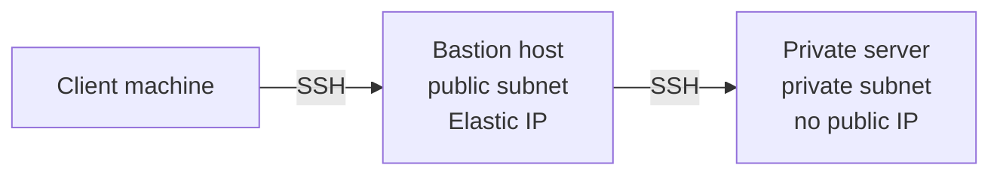

# AWS Bastion Host Setup and Debugging Guide

A hands-on walkthrough of building a bastion host (jump server) on AWS: a custom VPC, public and private subnets, an internet gateway, route tables, security groups, and SSH access to a private server, plus every problem I hit and how I fixed it.

**Region:** `us-east-1` (N. Virginia)
**Author:** Primre (Kelechi Gospel Cajetan)
**Medium write-up:** [paste your Medium link here]

---

## Table of Contents

1. [What We Built](#what-we-built)
2. [Prerequisites](#prerequisites)
3. [Step 1: Create the VPC](#step-1-create-the-vpc)
4. [Step 2: Create the Subnets](#step-2-create-the-subnets)
5. [Step 3: Create and Attach the Internet Gateway](#step-3-create-and-attach-the-internet-gateway)
6. [Step 4: Configure the Route Tables](#step-4-configure-the-route-tables)
7. [Step 5: Create the Security Groups](#step-5-create-the-security-groups)
8. [Step 6: Launch the EC2 Instances](#step-6-launch-the-ec2-instances)
9. [Step 7: Give the Bastion a Public Address](#step-7-give-the-bastion-a-public-address)
10. [Step 8: Connect Through the Bastion](#step-8-connect-through-the-bastion)
11. [Debugging Log](#debugging-log)
12. [Troubleshooting Table](#troubleshooting-table)
13. [Lessons Learned](#lessons-learned)
14. [Cleanup Checklist](#cleanup-checklist)
15. [Next Steps](#next-steps)

---

## What We Built

A bastion host is a hardened server in a public subnet that acts as the only entry point to servers in a private subnet. The private server has no public IP and cannot be reached from the internet directly.



| Component | Value |
|---|---|
| VPC | `myvpc`, CIDR `10.0.0.0/16` |
| Public subnet | `public-subnet`, `10.0.1.0/24`, `us-east-1a` |
| Private subnet | `private-subnet`, `10.0.2.0/24`, `us-east-1a` |
| Internet gateway | Attached to `myvpc` |
| Public route table | Route `0.0.0.0/0` to the internet gateway |
| Bastion instance | `myserver`, t3.micro, Ubuntu, Elastic IP attached |
| Private instance | Ubuntu, private IP only |
| Key pair | `my-key-pair` (`my-key-pair.pem`) |
| Client | Vagrant Ubuntu focal VM on a Windows PC |

---

## Prerequisites

- An AWS account with permission to create VPC and EC2 resources
- An EC2 key pair created in `us-east-1`
- An SSH client (OpenSSH on Linux, macOS, WSL, or a Vagrant VM)
- Your current public IP, which you can get with `curl -4 ifconfig.me`

---

## Step 1: Create the VPC

1. Open the AWS Console, search for **VPC**, and confirm the region is **us-east-1**.
2. Click **Your VPCs**, then **Create VPC**.
3. Choose **VPC only**.
4. Name tag: `myvpc`.
5. IPv4 CIDR block: `10.0.0.0/16` (65,536 addresses to split into subnets).
6. Leave IPv6 off and Tenancy as Default.
7. Click **Create VPC**.

---

## Step 2: Create the Subnets

**Public subnet**

1. VPC console, **Subnets**, then **Create subnet**.
2. VPC ID: `myvpc`.
3. Subnet name: `public-subnet`.
4. Availability Zone: `us-east-1a`.
5. IPv4 CIDR block: `10.0.1.0/24`.

**Private subnet**

1. Click **Create subnet** again and select `myvpc`.
2. Subnet name: `private-subnet`.
3. Availability Zone: `us-east-1a`.
4. IPv4 CIDR block: `10.0.2.0/24`.

> At this point both subnets are identical. A subnet becomes public only when its route table has a route to an internet gateway.

---

## Step 3: Create and Attach the Internet Gateway

1. VPC console, **Internet gateways**, then **Create internet gateway**.
2. Give it a name and click **Create**.
3. Select it, then **Actions**, then **Attach to VPC**, choose `myvpc`, and click **Attach internet gateway**.
4. Confirm the state shows **Attached**.

> If your account has more than one internet gateway, always pick the one attached to `myvpc`.

---

## Step 4: Configure the Route Tables

### Public route table

1. VPC console, **Route tables**, select the table for `myvpc`.
2. **Routes** tab, **Edit routes**, **Add route**.
3. Destination `0.0.0.0/0`, Target **Internet Gateway**, and choose your gateway.
4. **Save changes**.
5. **Subnet associations** tab, **Edit subnet associations**, tick `public-subnet`, and save.

Expected result:

| Destination | Target |
|---|---|
| `10.0.0.0/16` | `local` |
| `0.0.0.0/0` | `igw-xxxxxxxxxxxxxxxxx` |

### Private route table

Keep only the `local` route. It must not have a route to the internet gateway. If the private server later needs outbound internet access, add a NAT gateway in the public subnet and route `0.0.0.0/0` from the private table to it.

---

## Step 5: Create the Security Groups

### Bastion security group

| Type | Protocol | Port | Source |
|---|---|---|---|
| SSH | TCP | 22 | `<YOUR_PUBLIC_IP>/32` |

### Private instance security group

| Type | Protocol | Port | Source |
|---|---|---|---|
| SSH | TCP | 22 | Bastion security group (`sg-xxxxxxxxxxxxxxxxx`) |

Using the bastion's security group as the source means only the bastion can SSH to the private server, whatever IP it has.

---

## Step 6: Launch the EC2 Instances

### Bastion (`myserver`)

1. EC2 console, **Instances**, **Launch instances**.
2. Name: `myserver`.
3. AMI: Ubuntu Server (Ubuntu 24.04 LTS is the safer, more widely documented choice).
4. Instance type: `t3.micro`.
5. Key pair: `my-key-pair`.
6. Network settings: VPC `myvpc`, subnet `public-subnet`, and the bastion security group.
7. Auto-assign public IP: enable if offered. If not, attach an Elastic IP afterwards (Step 7).

### Private server

1. Launch another instance with the same AMI and key pair.
2. Network settings: VPC `myvpc`, subnet `private-subnet`, **Auto-assign public IP: Disable**.
3. Security group: the private instance security group from Step 5.

---

## Step 7: Give the Bastion a Public Address

If the public subnet has auto-assign public IPv4 set to **No**, the bastion launches without a public address. Fix it with an Elastic IP:

1. EC2 console, **Elastic IPs**, **Allocate Elastic IP address**.
2. Public IPv4 address pool: **Amazon's pool of IPv4 addresses**.
3. Network border group: the plain **us-east-1** entry (entries like `us-east-1-atl-2` are Local Zones and will not work).
4. Click **Allocate**.
5. Select the address, **Actions**, **Associate Elastic IP address**, Resource type **Instance**, choose the bastion (not the private server), and click **Associate**.

> **Cost note:** AWS bills hourly for every public IPv4 address, including Elastic IPs on running instances.

---

## Step 8: Connect Through the Bastion

Run these on your client machine:

```bash
chmod 400 my-key-pair.pem
eval "$(ssh-agent -s)"
ssh-add my-key-pair.pem
ssh -A ubuntu@<BASTION_ELASTIC_IP>
```

Then, from inside the bastion:

```bash
ssh ubuntu@<PRIVATE_SERVER_IP>
```

The `-A` flag forwards your key through the agent, so the private key file never has to be copied onto the bastion.

### One-command alternative (jump host)

```bash
ssh -i my-key-pair.pem -J ubuntu@<BASTION_ELASTIC_IP> ubuntu@<PRIVATE_SERVER_IP>
```

### Optional: SSH config

Add this to `~/.ssh/config`:

```text
Host bastion
    HostName <BASTION_ELASTIC_IP>
    User ubuntu
    IdentityFile ~/my-key-pair.pem

Host private-server
    HostName <PRIVATE_SERVER_IP>
    User ubuntu
    IdentityFile ~/my-key-pair.pem
    ProxyJump bastion
```

Then run `chmod 600 ~/.ssh/config` and connect with:

```bash
ssh private-server
```

---

## Debugging Log

### Problem 1: `No route to host` on the private IP

- **Command:** `ssh -i my-key-pair.pem ubuntu@<PRIVATE_SERVER_IP>` run directly from the Vagrant VM.
- **Cause:** The private IP is only reachable inside the VPC. VirtualBox/Vagrant NAT also uses the `10.0.2.0/24` range, so the VM looked for that address locally.
- **Fix:** Connect to the bastion's public address first, then hop to the private IP.

### Problem 2: No public address for the bastion

- **Cause:** The subnet had *Auto-assign public IPv4 address* set to No.
- **Fix:** Allocate and associate an Elastic IP (Step 7). Enabling auto-assign on the subnet only affects instances launched afterwards.

### Problem 3: Connection refused, then timed out on port 22

- **Tests run:**
  - `nc -vz -w 5 github.com 22` succeeded, so the local network allows outbound SSH.
  - `nc -vz -w 5 <BASTION_ELASTIC_IP> 22` timed out, so the block was on the AWS side.
- **Reading the errors:** A **timeout** means packets are silently dropped (security group, route table, or network ACL). A **refusal** means something actively rejected the connection, for example nothing listening on the port.

### Problem 4: No SSH rule on the bastion security group

- **Cause:** The inbound rules had no SSH entry.
- **Fix:** Add SSH, TCP, 22, with source `<YOUR_PUBLIC_IP>/32`. Find the IP from the client with `curl -4 ifconfig.me`.
- **Tip:** The console's **My IP** option uses the browser's address. If the client goes out through a different address, the rule will not match.
- **Tip:** Select the source from the dropdown (so it shows as a chip) before clicking **Save rules**.

### Problem 5: Missing internet route (the main cause of the timeout)

- **Finding:** The route table only had `10.0.0.0/16 -> local`. With no `0.0.0.0/0` route to an internet gateway, the subnet was not actually public.
- **Fix:** Add `0.0.0.0/0` pointing to the gateway attached to `myvpc` (not a gateway for another VPC).
- **Result:** `nc -vz -w 5 <BASTION_ELASTIC_IP> 22` printed `succeeded` and SSH to the bastion worked.

### Problem 6: Could not reference the bastion group in the private security group

- **Error:** `You may not specify a referenced group id for an existing IPv4 CIDR rule.`
- **Cause:** The existing SSH rule used an IP range (CIDR) as its source, and AWS will not convert it in place.
- **Fix:** Delete the old rule, add a new SSH rule with the bastion security group as the source, and save. This also removed an overly open rule.

### Problem 7: `ssh-add -l` inside the bastion reported no authentication agent

- **Cause:** The first session was opened with `ssh -i` and without `-A`, so the key was never forwarded.
- **Fix:** Exit to the client, run `eval "$(ssh-agent -s)"` and `ssh-add my-key-pair.pem`, reconnect with `ssh -A ubuntu@<BASTION_ELASTIC_IP>`, then run `ssh ubuntu@<PRIVATE_SERVER_IP>`.

---

## Troubleshooting Table

| Symptom | Likely cause | Fix |
|---|---|---|
| `No route to host` | Using a private IP from outside the VPC | Go through the bastion's public address |
| Connection timed out to the bastion | Missing `0.0.0.0/0` route, no SSH rule for your IP, wrong IP in the rule, or a restrictive network ACL | Check the route table, the security group source, and the network ACL |
| Connection refused | Nothing listening on port 22 (SSH not started or instance still booting) | Check status checks and the system log, or relaunch on Ubuntu 24.04 LTS |
| `Permission denied (publickey)` | Wrong key pair or username | Use the key the instance was launched with; the user is `ubuntu` on Ubuntu AMIs |
| Timed out only on the hop to the private IP | Private security group does not allow SSH from the bastion group | Add the SSH rule with the bastion security group as the source |
| `Could not open a connection to your authentication agent` | Agent forwarding not active | Run `ssh-agent` and `ssh-add` on the client, then connect with `-A` |
| `UNPROTECTED PRIVATE KEY FILE` | Key permissions too open (common in the `/vagrant` shared folder) | Copy the key into the VM home directory and run `chmod 400` |

### Useful diagnostic commands

```bash
nc -vz -w 5 <ip> 22                       # is port 22 reachable?
curl -4 ifconfig.me                       # what public IP am I coming from?
ssh -v -i my-key-pair.pem ubuntu@<ip>     # verbose SSH output
ssh-add -l                                # which keys are loaded in the agent?
```

In the console, **VPC Reachability Analyzer** can trace the path from the internet gateway to the instance and name the blocking component.

---

## Lessons Learned

1. A subnet is only public if its route table has a route to an internet gateway, and a bastion needs a public IP as well.
2. "Timed out" and "refused" mean different things. Timeouts point to AWS networking; refusals point to the host.
3. Test one layer at a time: client network, security group, route table, internet gateway, network ACL, then the instance.
4. Security group references (one group as another group's source) are safer than IP ranges for internal access.
5. Use agent forwarding or a jump host instead of copying private keys onto servers.
6. Your home or ISP address can change, so update the bastion SSH rule if connections start timing out.

---

## Cleanup Checklist

- [ ] Terminate both EC2 instances
- [ ] Release the Elastic IP (**Elastic IPs**, **Actions**, **Release Elastic IP addresses**)
- [ ] Delete the custom security groups, subnets, and route tables
- [ ] Detach and delete the internet gateway
- [ ] Delete the VPC
- [ ] Delete any NAT gateway you added (it also bills hourly)

---

## Next Steps

- Add a NAT gateway in the public subnet so the private server can download updates without being exposed
- Try AWS Systems Manager Session Manager as a bastion-free way to reach private instances
- Practise SSH tunnelling with `ssh -L` to reach services on the private instance
- Harden the bastion with a fixed source IP range, key-only login, and fail2ban or logging

---

## Security Note

Never commit `.pem` files, real IP addresses, account IDs, or resource IDs to a public repository. Add this to your `.gitignore`:

```text
*.pem
*.key
```

---

## Author

**Primre (Kelechi Gospel Cajetan)**
Cloud engineering student | AWS | Linux | Customer success background

Connect on [LinkedIn] www.linkedin.com/in/gospel-cajetan and read the full story on [Medium] https://medium.com/@kcajetan/how-i-built-an-aws-bastion-host-and-fixed-7-things-that-went-wrong-456df1acd9aa?sharedUserId=kcajetan